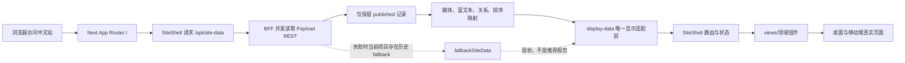
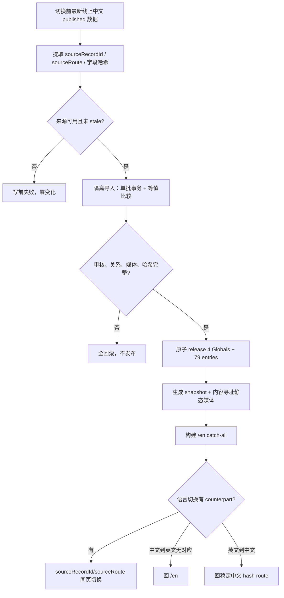

# 前端架构与开发规范

本文同时承担两种职责：左侧是卓建官网 V1.3.5 的当前事实，右侧是下一个 Payload + 独立 Next.js 项目应采用的推荐规范。两者不可混写。当前项目有历史兼容、hash route 和静态英文快照等特例；推荐规范应保留其有效原则，但不应机械复制实现。

## 1. 技术基线与边界

| 主题 | 卓建 V1.3.5 当前事实 | 下个项目推荐规范 |
| --- | --- | --- |
| 框架 | Next.js 16.2.6 App Router、React 19.2.6、TypeScript | 锁定经过验证的兼容版本；升级单独成批 |
| 中文入口 | `src/app/page.tsx` → 客户端 `SiteShell`；hash route | 优先使用可索引、可测试的 App Router 路由；是否 hash 由产品约束决定 |
| 英文入口 | `/en/[[...slug]]/page.tsx` → `EnglishSiteShell` | locale 路由与发布模型在需求阶段确定 |
| CMS 读取 | 同源 BFF `/api/site-data` 聚合 Payload | 浏览器不直接依赖 Payload 原始 schema |
| 显示模型 | BFF → display-data → Shell → views | 保持唯一适配层和稳定页面 ViewModel |
| 英文内容 | 构建时静态 JSON snapshot + 静态媒体 | 内容发布产物与代码构建解耦，快照不可变 |
| 路由映射 | `sourceRecordId/sourceRoute` | 所有跨语言详情使用稳定来源身份，不盲拼 slug |
| 时间 | 存 UTC，中文显示/统计用 Asia/Shanghai | 数据时区、展示时区、统计自然日三者显式定义 |

## 2. 当前目录职责

| 路径/模块 | 当前职责 | 修改时的边界 |
| --- | --- | --- |
| `src/app/page.tsx` | 中文根页面入口 | 不在入口堆业务数据转换 |
| `src/app/en/[[...slug]]/page.tsx` | 英文 catch-all，解析 route 并渲染静态数据 | 未发布/非法 route 明确 404；不中文 fallback |
| `src/app/api/site-data/route.ts` | 中文 BFF：并发拉取已发布资源、媒体/富文本/关系映射 | 不偷偷改变资源位或排序语义 |
| `src/app/api/media/file/[...filename]/route.ts` | 公开媒体同源代理 | 规范化路径、拒绝穿越、禁止 private |
| `src/app/api/job-application/route.ts` | 匿名求职入口 | body 上限先于完整缓冲，代理头可信化 |
| `src/app/api/analytics/track/route.ts` | 匿名埋点入口 | 小 body 上限、稳定响应、失败不影响主页面 |
| `src/components/SiteShell.tsx` | 中文路由状态、数据加载、语言切换、analytics | 不继续吸收所有页面渲染细节 |
| `src/components/EnglishSiteShell.tsx` | 英文 route、静态数据和中文映射 | 不运行时读取中文内容作为 fallback |
| `src/components/site-shell/display-data.ts` | Payload 输出到中文显示模型 | 只能有一个正式真相，不丢关系字段 |
| `src/components/site-shell/views.tsx` | 中文页面视图集合 | 已偏大；新增复杂模块先拆成领域组件 |
| `src/components/english-site-shell/display-data.ts` | 英文快照到显示模型 | provenance/route/关系必须保留 |
| `src/data/english-site-data.json` | 已审计英文发布快照 | 不是手工编辑源；内容变化走发布流程 |
| `src/i18n/locale-route-map.ts` | 双语稳定路由映射 | 不使用文本标题或猜测 slug |
| `scripts/generate-english-snapshot.mjs` | 生成英文静态快照和内容寻址媒体 | 当前 prebuild 联网是 P2；勿在普通 build 隐式改内容 |
| `tests/` | 契约、路由、排序、响应式和安全回归 | 测真实调用链，不只正则检查源码 |

## 3. 运行时数据流

关键点：BFF 是契约边界，不是转发代理。它负责只暴露已发布内容、媒体路径收敛、富文本处理、关系归一化和业务排序。display-data 是页面模型边界，不得另起一套并行 mapper，也不得把 BFF 已生成的 `relatedNews` 设为 `undefined`。

英文页面的运行时不同：服务端直接导入经过发布审核的 `english-site-data.json`，根据 `/en` route 选择页面数据，媒体来自静态 `english-media`。运行时不请求中文 Payload 来补缺。

## 4. 中英文路由与发布流

当前项目的发布条目数和具体栏目是卓建特例。通用规则是：来源身份稳定、字段级 provenance、写前 stale、事务、幂等、关系完整、媒体可追溯、缺失 fallback 明确。

## 5. 数据类型与适配规则

### Payload 原始类型

原始响应包含 `_status`、关系对象或 ID、Lexical JSON、media 对象、系统时间和可能的 null。页面组件不应直接使用这些联合类型。BFF 先完成：

- 过滤非 published；
- 将关系统一为稳定的轻量对象；
- 将 media 转成同源公开 URL；
- 将 Lexical 转成安全、可渲染的结构；
- 将日期保留为时间戳用于排序，在显示边界格式化；
- 为缺失值定义明确的 `null/[]/hidden`，不伪造内容。

### ViewModel 规则

ViewModel 应围绕页面消费命名，例如 `LawyerCard`、`RelatedNewsLink`、`HomeColumn`，而不是复制 Collection 全字段。字段删除要先更新消费矩阵，再同时处理 BFF、ViewModel、组件、测试和旧契约。

### 状态层次

页面至少区分：

1. 初次 loading；
2. 有效 published 数据；
3. 有效但为空；
4. 请求失败；
5. route 不存在；
6. 媒体单项失败；
7. 公开写接口提交中/成功/4xx/5xx。

禁止把所有异常都显示成“暂无内容”，否则会把数据断链伪装成正常空栏目。

## 6. 路由规则

### 中文当前规则

中文 SiteShell 解析 hash 中的页面和 detail route。修改时必须验证直接打开、刷新、前进/后退、详情返回列表、无效 route 和语言切换。动态详情链接由受控 route 数据生成，不在组件里拿标题拼 slug。

### 英文当前规则

`/en/[[...slug]]` 是 App Router catch-all。route 必须存在于已发布快照，否则 404。相关文章使用 locale route；无对应英文 target 时回 `/en`，禁止落到中文内容。

### 通用规则

- stable ID 负责跨语言身份，slug 负责可读 URL，二者不要混为一谈；
- 静态页也要进入 locale map；
- 关系链接和语言切换共用同一映射规则；
- 列表、详情、静态页分别写正反例；
- 不能只测试 href 字符串，要测试目标页面和 locale。

## 7. 排序与资源位

卓建当前顺序：置顶/固定位置 > 首页推荐、栏目资源位、featured > 显式 `sortOrder` > `publishedAt` 并列降序 > 稳定 ID。具体 comparator：

- 新闻：pin 顺序 1–3，随后 `publishedAt` 降序，再 ID；
- 文化/社会责任/党建：`sortOrder` 升序，同值时 `publishedAt` 降序，再 ID；
- 首页四栏：仅 published + featured News，按 category 分栏，`sortOrder` 后 `publishedAt`；
- 律师：`sortOrder`、姓名、ID，不消费 `publishedAt`。

推荐规范是为每个列表写“排序决策表”，并用乱序输入数组断言完整输出。不要只测 comparator 文件存在，不要在公共工具里统一替换所有栏目排序，也不要把“最新”误解成覆盖运营资源位。

## 8. 字段消费与时间

V1.3.1 已从 admin/API schema 移除六个零 consumer 字段，历史数据库列保留。新增或删除字段的必走流程：

1. 更新页面字段消费矩阵；
2. 搜索 CMS schema、hook、access、脚本、BFF、显示模型、视图、测试和文档；
3. 区分“不显示”“API 不暴露”“物理删列”；
4. 旧数据存在时先在副本验证 schema 行为；
5. 需要 migration 时单独设计和回滚。

时间值在数据库和 REST 中保持 UTC ISO；显示用 `Intl.DateTimeFormat` 指定 `Asia/Shanghai`；Analytics 自然日也用上海时区上下界。排序比较时间戳，不比较格式化字符串。禁止 `iso.slice(0,10)`。

## 9. 媒体与附件

公开媒体规则：

- 运营先上传素材中心，再由内容建立关系；
- BFF 只输出同源、安全的公开路径；
- media 代理拒绝 `..`、编码穿越和 private 目录；
- 图片尺寸、类型、替代文本和失败占位有契约；
- 英文静态媒体按内容哈希命名并校验 provenance。

私有附件规则：

- 不进入 public media，不被静态快照复制；
- 匿名用户只能通过专用求职 route 上传；
- 下载和删除通过明确 ACL；
- application 删除只清理孤立 resume，共享 resume 保留；
- 失败时记录、关系和物理文件保持一致；
- 当前跨步骤原子性仍是 P2。

## 10. 公开写接口与安全边界

公开写接口不是普通 API route。必须在解析 body 前：

- 校验 Content-Length 声明上限；
- 用流式 reader 统计真实字节，覆盖 chunked/无长度；
- 不采用畸形、不可信或多跳代理头，也不向内层转发该头；
- 仅在能够验证时转发客户端地址语义，否则让限流键回退到 UA/anonymous；
- 限制 Content-Type 和字段形态；
- 对请求超限、格式或字段校验错误返回稳定 4xx，不泄露内部错误；
- 保留正常匿名请求契约。

前端代理和 CMS route 要有对称保护。Job application 当前上限为合法简历容量加小幅表单余量，Analytics 使用更小的硬上限。数字是项目事实，新项目应按业务附件限制重算。

草稿读取也属于前端安全契约：Global 匿名 published 可读，但 REST/Local API 的 draft 都要求 active 用户；停用、删除或查询异常后的旧会话必须拒绝。

## 11. 错误与 fallback

推荐的 fallback 原则：

- 内容源失败时显示可识别错误或受控维护态，不用旧 mock 冒充最新正式内容；
- 英文缺翻译回 locale 首页，不回中文；
- 单项媒体失败用占位，不让整个列表崩溃；
- Analytics 失败不阻断页面，但要可观测；
- 表单失败保留用户可重试状态，不把未知 5xx 显示成成功；
- 任何 fallback 都要有来源、适用环境和测试，禁止 mock/seed/snapshot 互相反哺。

当前中文 `fallbackSiteData` 是历史兼容，修改它需要独立范围和产品决策。

## 12. CSS、响应式与组件边界

### CSS 规则

- 用容器和组件 scope 限制影响，不用全局选择器修单页；
- 桌面调整不得通过共享规则改变移动端；
- 中文 Footer 调整不得波及英文 Footer；
- 伪元素、绝对定位和 overflow 都要检查计算样式；
- 导航当前页下划线、Hero 进度条等视觉相似元素必须通过 DOM 身份区分；
- 视觉隐藏不应留下可点击、可聚焦或占空间的节点。

V1.3.5 的 Footer 对齐只在中文桌面目标布局增加最小规则，是好例子：两文件、明确 selector、移动端和英文不变。

### 组件边界

`views.tsx` 已承载大量页面，应停止无限增长。新增复杂页面时按领域拆：数据纯函数、可复用视觉组件、页面容器、交互状态分开。Shell 只负责全局数据、路由、语言和埋点，不承载每个栏目细节。

## 13. 测试金字塔

| 层级 | 验证对象 | 典型证据 |
| --- | --- | --- |
| 纯函数 | 时间、排序、route map、body limit | 输入输出和边界样例 |
| 契约测试 | BFF/display-data/英文快照/权限矩阵 | 真实模块调用，禁止仅正则 |
| Payload 集成 | REST/Local API、旧会话、事务、hook | 隔离 SQLite、真实登录与故障注入 |
| 构建 | typecheck、生产 build、静态资产 | 双端命令成功、产物不意外改写 |
| 浏览器 | 页面、后台、响应式、network/console | 1440/390、三角色、真实点击 |
| 部署门禁 | 备份、loopback、原子切换、回滚 | release/symlink/DB/media/env 不变量 |

测试必须与风险相称。小 Footer 修改不需要重跑所有生产负例，但权限、事务、安全边界必须行为级覆盖。HTTP 200 只是网络层证据。

## 14. 性能与可维护性

- BFF 并发读取独立资源，避免串行瀑布；
- 只返回页面需要字段，关系对象轻量化；
- 静态英文减少运行时 CMS 压力，但发布生成必须可审计；
- 图片使用适当尺寸和缓存，不把原图塞进列表；
- analytics 不阻塞主要交互；
- 避免每个 view 自己转换日期、媒体和关系；
- 生成文件必须可重复、相同输入零变化；
- build 不应隐式联网或写内容快照；当前该项仍是 P2。

## 15. 反屎山规则

1. 禁止多个并行 display-data 真相。任何新 mapper 要么成为唯一入口，要么只是明确的纯函数子模块。
2. 禁止继续把所有页面塞进超大 `views.tsx`；新增复杂功能先拆领域组件。
3. 禁止 BFF 默默丢字段。字段过滤必须有契约和测试。
4. 禁止用 CSS 伪元素承载不可见的业务契约；DOM、可访问性和交互要可测试。
5. 禁止动态路由盲拼 slug；跨语言和关系用 stable source identity。
6. 禁止 mock、seed、fallback、snapshot 互相成为生产来源。
7. 禁止 prebuild 隐式联网改发布产物；当前风险要保留 P2 标识。
8. 禁止把 HTTP 200、PID 或 build pass 当最终验收。
9. 禁止为一个小补丁顺手统一 CSS、重写 Shell 或迁移数据库。
10. 禁止通过 UI 隐藏替代 access control。

## 16. 新增页面 checklist

- [ ] 页面属于列表、详情、静态页还是资源位？
- [ ] URL/hash 和直接访问规则是什么？
- [ ] loading、空、错误、404 状态是否定义？
- [ ] 字段消费矩阵是否更新？
- [ ] BFF/ViewModel/组件边界是否清楚？
- [ ] 桌面与移动端是否使用真实内容测试？
- [ ] 语言切换和关系链接是否覆盖？
- [ ] console、network、媒体、overflow 是否验收？

## 17. 新增字段 checklist

- [ ] 谁编辑、谁读取、在哪里显示或排序？
- [ ] draft/published 和权限语义是什么？
- [ ] null/旧记录/fallback 如何处理？
- [ ] Payload 类型、BFF、ViewModel、页面和测试是否同时更新？
- [ ] 是否真的需要数据库字段，还是 Global/关系/派生值？
- [ ] 删除时是隐藏 API 还是物理迁移？

## 18. 新增关系 checklist

- [ ] 关系基于 ID，不基于标题文本？
- [ ] 删除目标后的行为定义？
- [ ] mapper、snapshot、display-data、view 全链路保留？
- [ ] 中英文 counterpart 缺失时去哪？
- [ ] 链接是否真实点击验证？

## 19. 新增语言 checklist

- [ ] 来源权威和覆盖范围冻结？
- [ ] record/field provenance 和 stale 规则？
- [ ] 单批事务、故障回滚、幂等零写？
- [ ] 稳定 route map 和无翻译 fallback？
- [ ] 关系和媒体能否映射？
- [ ] 汉字泄漏、private 泄漏和媒体完整性扫描？
- [ ] 内容发布与代码构建是否解耦？

## 20. 新增媒体 checklist

- [ ] public/private 分类？
- [ ] 类型、大小、尺寸、alt 和复用规则？
- [ ] 同源代理和路径穿越测试？
- [ ] 删除/共享/孤立清理语义？
- [ ] 备份、快照、哈希和部署不变量？

## 21. 新增公开写接口 checklist

- [ ] 能否避免匿名通用 Collection create？
- [ ] Content-Length 与流式实际字节上限都在解析前？
- [ ] 可信代理链已只读确认，伪造 XFF 正负例？
- [ ] Content-Type、字段、文件类型和大小限制？
- [ ] rate limit 的实例范围是否说清？
- [ ] 数据/文件写入是否原子或有补偿？
- [ ] 4xx/5xx 是否稳定且不泄密？
- [ ] 正常匿名请求和后台流程不回归？

## 22. 发布与回滚

前端发布仍须尊重运行资产边界。代码包不能携带或覆盖线上 SQLite、public media、private、env。部署前从即时备份开始，在服务器副本完成构建/loopback/数据库检查，再原子切换 release symlink。生产的实际 release 路径、env 布局、symlink 所有者和权限必须当次只读核对；旧脚本不是事实。

Git 收口使用单一清晰 commit、普通 non-force push、不可变 annotated tag，并远端回读 branch SHA、commit tree、tag object、peeled commit/tree。当前项目不使用 publisher、wrapper、dry-run、doctor 或部署锁。

回滚不仅是把 symlink 指回旧 release，还要确认数据库、public media、private、env 和并发业务写入没有被错误回退或覆盖。若本次没有 schema/data 写入，回滚边界应明确写“代码 release 回滚”；若有数据变更，必须有独立恢复方案。

## 23. 当前中文 SiteShell 的开发约束

中文 SiteShell 同时承载数据加载、hash route、语言切换和 analytics，是现有架构的稳定入口。维护时应把它视为协调层：它可以决定当前页面和全站状态，但不应继续吸收每个栏目专属的排序、字段转换或视觉细节。栏目数据转换放在 display-data 的纯函数或领域模块；页面交互放在对应组件。

hash route 的历史优势是不用重写既有静态 URL 结构，成本是服务端无法天然理解详情状态，直接访问、刷新、前进后退和 SEO 都更难。卓建当前不在维护批次重写 route。新项目如果没有历史约束，优先用 App Router 的显式 segment，把 route 参数、404 和 metadata 放到服务端可见边界。

修改 SiteShell 时至少验证：初次加载只请求一次必要数据；route 变化不重复注册监听；直接打开详情能恢复状态；浏览器返回能回到正确列表；语言切换使用当前实体的 stable identity；analytics 不因 rerender 重复记同一次页面访问；请求失败与空栏目不混淆。

## 24. 当前英文 EnglishSiteShell 的开发约束

EnglishSiteShell 消费构建时导入的静态快照，不在运行时查询中文 Payload。页面 route 由 `/en/[[...slug]]` 解析，未发布或不存在的路径明确 404。列表、详情、静态页和关系链接都应从 snapshot 的正式 route 生成。

修改英文页面时不能为了方便读取中文 fallback，也不能从中文 SiteShell 抄一段动态查询。若需要新增英文内容类型，应先扩展来源提取、provenance、导入、release、snapshot、route map 和媒体清单，再让视图消费。只在 JSON 中手改一条英文记录会破坏来源和下一次生成。

英文内容经常比中文更长，响应式测试要覆盖长单词、机构名称、导航换行、按钮宽度和卡片标题。不得用全局 `overflow:hidden` 掩盖真正溢出，也不得通过缩小字号破坏全站层级。先定位产生 scrollWidth 的真实节点和伪元素。

## 25. BFF 资源获取和错误策略

当前 `/api/site-data` 对独立 Payload 资源并发请求，减少串行等待。每个资源有明确 path、sort 或 limit；返回后只保留 published。新增资源时应把资源定义、请求、mapper、返回契约和测试同批修改，不能把临时 fetch 散落在 route 中。

部分资源失败时的策略要按业务决定：核心站点设置失败可能使整页不可用；某个次要栏目失败可返回受控空态并记录错误。当前历史 fallback 仍可能在总体请求失败时提供本地数据，这会让页面看似可用却不是最新生产内容。维护者不能扩大 fallback 的使用，更不能让“任一字段缺失”触发整套旧数据覆盖。

BFF 错误响应不暴露 Payload 内部 URL、凭据、SQL 或堆栈。日志可以记录资源名、状态和请求标识，但不记录 private 数据。缓存策略要与运营发布时效匹配；当前 route 明确 dynamic/no-store，若未来引入缓存必须设计发布失效，而不是只为了性能加长 TTL。

## 26. 媒体代理的实现要求

媒体路径应先解析为受控相对路径，再映射到可信来源。拒绝 `..`、反斜线混用、重复编码、绝对路径、协议 URL 和 private 前缀。响应 Content-Type 以可信元数据或实际内容为准，不能把任意文件作为图片回传。

公开图片缺失时，列表可显示不改变布局的占位；详情可隐藏非必需图，但要在 network 验收中记录 404。不要让媒体代理吞掉所有错误并返回 200 空内容，因为浏览器会显示破图且监控难以发现。

英文静态媒体采用内容哈希，页面不得回退到 `/api/media/file`。相同内容复用同一文件，来源变化产生新哈希；清理旧媒体要基于 release manifest 和引用，不按修改时间盲删。

## 27. Analytics 的前端边界

Analytics 是辅助能力，不能阻塞页面导航、表单或主要渲染。客户端只发送允许的事件类型和最小必要字段；服务端校验数组/对象形态、时间、route 和 body 上限。错误响应不应造成无限重试或 console 噪声。

自然日汇总按 Asia/Shanghai，事件存储仍是 UTC。PV、UV、点击的定义要在业务文档固定，不能因为组件重构改变事件命名。测试环境和浏览器回归产生的事件不得写入生产；生产验收如需触发，应使用非敏感、可识别的最小样例并遵循授权。

当前 rate limit 为进程内状态，重启或多实例不会共享。这足以作为现有轻量保护的一部分，但不是分布式风控。若未来流量或攻击面扩大，应独立评估网关/共享存储，不在普通页面开发中偷偷引入 Redis 或新表。

## 28. 求职表单的前端边界

表单首先给用户清楚的必填、文件类型、大小和隐私提示。提交中防重复点击；4xx 区分字段错误、文件过大和频率限制；未知 5xx 提示稍后重试，不能显示成功。成功后是否清空字段、是否给编号由产品明确。

前端校验只改善体验，服务端必须重复校验。请求总字节上限需要包含 multipart 边界和普通字段，不只看简历文件大小。Content-Length 可缺失，因此流式计数不可省略。客户端地址只使用已验证代理链语义，UA 只能作为辅助维度，不能成为唯一可靠身份。

application、resume、物理文件的写入一致性是延期 P2。当前代码修改若碰到这一链，必须先说明是否扩大到原子事务/补偿设计；不能以“顺手修一下上传失败”在没有副本和回滚时改变生产数据生命周期。

## 29. CSS 修改的判定步骤

第一步定位真实 DOM：目标节点属于中文还是共享、桌面还是移动、是否有伪元素、是否可点击/聚焦。第二步找最窄的已有容器或 locale class。第三步用一条最小规则实现，不通过大范围 reset。第四步检查同名 class 在其他页面和英文站的使用。

视觉删除有三种不同动作：不渲染节点、`display:none`、只去掉视觉样式。若节点仍可交互或占空间，单纯透明不可接受。轮播指示器隐藏时要保留 autoplay 和 slide 逻辑；Footer 对齐时不能改变移动端堆叠；整句链接时 anchor 应覆盖全部可见文字但保持原 target/rel。

测试除了截图还应检查 DOM 数量、computed display、bounding box、scrollWidth、点击目标和导航下划线等相邻元素。小修改如果用户明确不要浏览器回归，可以用静态契约和 typecheck 收口，但生产发布仍应按授权执行必要 smoke。

## 30. 类型和生成文件治理

Payload 生成类型是 schema 的结果，不是手工业务源。Collection 字段变化后应运行官方生成命令并审查 diff，尤其防止无关版本或旧数据库造成大面积重写。只改前端 CSS 不应触碰 payload-types。

英文 snapshot 也是生成文件，但它承载正式内容，因此变化门槛高于普通代码生成。若命令只改 `generatedAt`、内容/关系/media/sourceHash 均未变，候选应恢复原 blob，避免制造无意义发布差异。生成命令必须有隔离输入和幂等证据。

测试 fixture、coverage、构建缓存、数据库和软链接不进入候选。changed-files 审计不仅看扩展名，还要看未跟踪文件和文件类型。敏感扫描应覆盖 env、SQLite、私钥、token/cookie 形态和 private 路径，但不能把字段名 `token` 或文档中的安全术语一概当泄密。

## 31. 性能预算与观察方式

当前站点的首要性能目标是可预测地加载已发布内容和媒体，不因单个栏目阻塞全站。观察 BFF 总耗时、最慢资源、响应体大小、首页图片尺寸、客户端 hydration 和移动端长任务。不要只看 Lighthouse 总分，也不要为分数牺牲运营发布时效或正确错误态。

对于中文动态数据，减少重复 fetch、限制关系展开深度、只输出 View 所需字段。对于英文静态数据，按页面选择需要的条目，避免把全部正文送到每个 route；如果未来体量显著增长，可拆分快照，但必须保留 manifest 和 route 完整性。

性能改动单独成批，先量化瓶颈。不要借 Footer 或权限补丁升级 Next、替换图片系统、引入全局缓存或重写 Shell。性能优化同样要证明内容、路由、权限和发布不回归。

## 32. 可维护性评审问题

每次合并前问：这段转换是否已有唯一入口？这个字段是否有消费矩阵？这个 route 是否使用 stable identity？这个 CSS selector 是否只命中目标 locale/viewport？这个 fallback 是否可能掩盖生产错误？这个测试是否调用真实入口？这个生成步骤是否会联网或改正式内容？这个权限是否只隐藏 UI？

如果答案需要“开发者记得”才能成立，就应该用类型、配置、测试或文档固化。若固化会扩大当前补丁，先登记下一批，不用临时复制一套实现。维护性不是一次重构的结果，而是每个小批次都拒绝新增第二真相。

## 33. 当前事实与推荐规范的最终对照

卓建当前保留 hash route、中文 fallbackSiteData、超大 views 文件和 prebuild snapshot generator，这些是历史兼容或延期技术债。文档如实说明它们，不把它们包装成最佳实践。推荐的新项目使用显式 App Router、受控错误态、领域组件和内容发布/代码构建分离。

卓建已经验证有效、值得直接迁移的方法包括：字段消费矩阵、权限五层、published-only BFF、stable source identity、字段级 provenance、单批事务与零写幂等、内容寻址媒体、UTC/业务时区分离、解析前 body 上限、真实 REST/Local API/会话/文件系统测试、不可变 tag 和运行资产分离。

迁移方法时始终重新回答业务问题。框架版本、role 名称、栏目数量、排序规则、时区、语言 fallback、数据库和代理链都必须由新项目事实决定。
